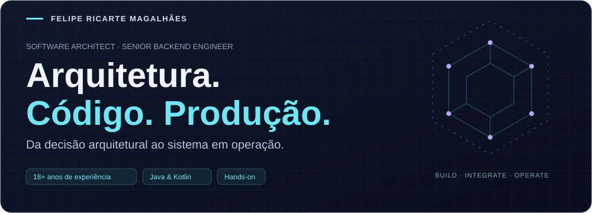
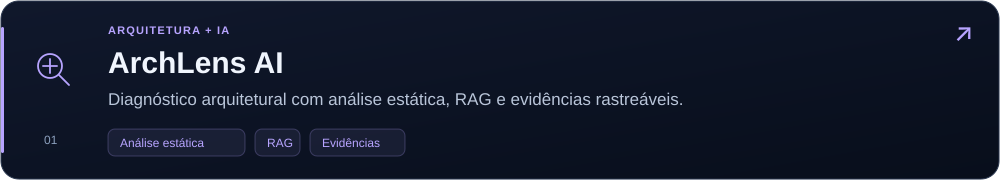
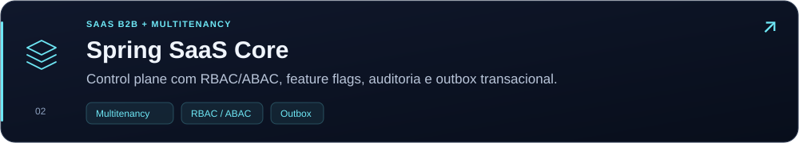
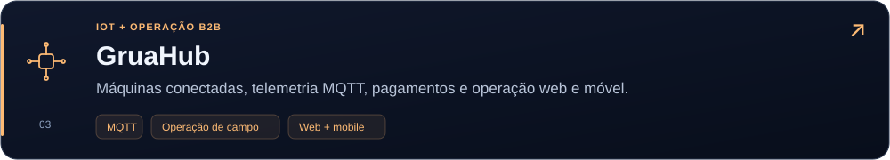
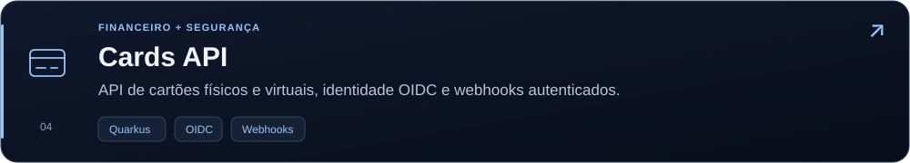
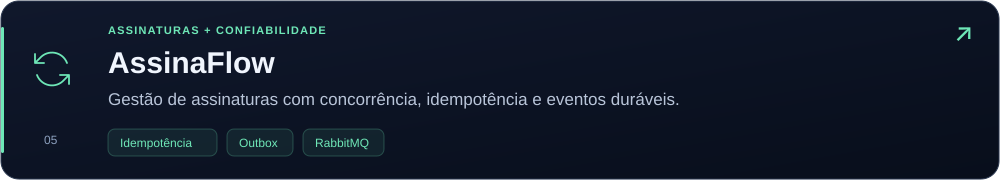
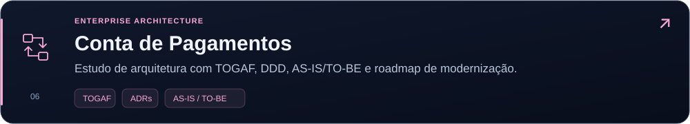

<picture>
  <source media="(max-width: 600px)" srcset="./assets/profile/header-mobile.svg">
  
</picture>

<h1 align="center">Software Architect & Tech Lead & Senior Backend Engineer</h1>

  <strong>Java &amp; Arquiteto de Software · Tech Lead · Senior Backend Engineer · Java · Kotlin · Spring Boot · Quarkus · Ruby on Rails · Go · Python · Sistemas distribuídos · Arquitetura orientada a eventos · Kubernetes · Cloud Computing ( AWS · Azure · GCP )</strong>

  
  
  
  

  <a href="#sobre">Sobre</a> &nbsp; / &nbsp;
  <a href="#projetos-selecionados">Projetos</a> &nbsp; / &nbsp;
  <a href="#repertório-técnico">Stack</a> &nbsp; / &nbsp;
  <a href="#mais-projetos">Mais projetos</a> &nbsp; / &nbsp;
  <a href="#conteúdo-e-contato">Contato</a>

## Sobre

Sou arquiteto de software e desenvolvedor backend sênior, com mais de 18 anos de experiência em sistemas corporativos, financeiros, bancários e distribuídos. Minha atuação conecta definição arquitetural, desenvolvimento e liderança técnica, acompanhando as decisões até sua implementação e operação.

Construí minha trajetória perto do código e dos problemas reais: investigar incidentes, entender sistemas legados, melhorar performance, integrar aplicações e evoluir plataformas que precisam continuar funcionando enquanto mudam.

**\*\*Meu foco:** \*\*arquitetura de software, liderança técnica, desenvolvimento backend com Java, Kotlin, Spring Boot, Quarkus, Ruby on Rails, Go e Python, sistemas distribuídos, arquitetura orientada a eventos, microsserviços, modernização de sistemas legados, integrações corporativas, plataformas SaaS B2B, Cloud Computing (AWS, Azure e GCP), Kubernetes, escalabilidade, segurança, observabilidade e confiabilidade em produção.

### Como trabalho

- **Domínio e contexto primeiro.** Entendo os fluxos de negócio, as integrações e os riscos antes de escolher tecnologia.
- **Arquitetura com implementação.** Participo do desenho, do código, da revisão e do troubleshooting, com contratos claros e responsabilidades bem definidas.
- **Distribuição com responsabilidade.** Idempotência, outbox, retry, DLQ, reprocessamento e consistência fazem parte do desenho.
- **Operação desde o início.** Segurança, métricas, logs, tracing, migrations e recuperação acompanham a entrega.
- **Qualidade demonstrável.** TDD, testes automatizados e integração contínua ajudam a sustentar as decisões e a evolução.

## Projetos selecionados

Uma seleção de arquitetura aplicada, plataformas B2B e sistemas transacionais. Cada cartão abre o repositório, com documentação e detalhes da implementação.

  <a href="https://github.com/ricartefelipe/archlens-ai">
    <picture>
      <source media="(max-width: 600px)" srcset="./assets/profile/archlens-ai-mobile.svg">
      
    </picture>
  </a>

  <a href="https://github.com/ricartefelipe/spring-saas-core">
    <picture>
      <source media="(max-width: 600px)" srcset="./assets/profile/spring-saas-core-mobile.svg">
      
    </picture>
  </a>

  <a href="https://github.com/ricartefelipe/gruahub">
    <picture>
      <source media="(max-width: 600px)" srcset="./assets/profile/gruahub-mobile.svg">
      
    </picture>
  </a>

  <a href="https://github.com/ricartefelipe/cards-api">
    <picture>
      <source media="(max-width: 600px)" srcset="./assets/profile/cards-api-mobile.svg">
      
    </picture>
  </a>

  <a href="https://github.com/ricartefelipe/assinaflow">
    <picture>
      <source media="(max-width: 600px)" srcset="./assets/profile/assinaflow-mobile.svg">
      
    </picture>
  </a>

  <a href="https://github.com/ricartefelipe/visao-arquitetura-conta-pagamentos">
    <picture>
      <source media="(max-width: 600px)" srcset="./assets/profile/conta-pagamentos-mobile.svg">
      
    </picture>
  </a>

## Repertório técnico

**Backend e arquitetura são minha base principal.** Frontend e mobile também fazem parte da minha experiência de implementação e integração de ponta a ponta.

| Frente | Tecnologias e práticas |
| :--- | :--- |
| **Backend e APIs** | Java · Kotlin · Spring Boot · Quarkus · Node.js · Python · REST · OpenAPI/Swagger · gRPC · BFFs |
| **Arquitetura** | DDD pragmático · Arquitetura hexagonal · Monólitos modulares · Microsserviços · Multitenancy · TOGAF · ArchiMate · C4 · ADRs |
| **Dados e cache** | PostgreSQL · Oracle · PL/SQL · SQL Server · MariaDB · MongoDB · Redis · Liquibase · Flyway |
| **Eventos e integração** | Kafka · RabbitMQ · AWS SQS · EventBridge · GCP Pub/Sub · IBM MQ · Outbox · Idempotência · Retry · DLQ · Reprocessamento |
| **Segurança** | Keycloak · OAuth2 · OpenID Connect · JWT · RBAC · ABAC · Auditoria · Segurança de APIs |
| **Cloud e plataforma** | AWS · Azure · GCP · Docker · Kubernetes · OpenShift · Terraform · CI/CD · Serverless |
| **Observabilidade** | OpenTelemetry · Micrometer · Prometheus · Grafana · ELK · Datadog · New Relic · Jaeger |
| **Qualidade** | TDD · JUnit · Mockito · Testcontainers · JaCoCo · Sonar · Migrations versionadas · Estratégias de rollback |
| **Frontend e mobile** | Angular · AngularJS · React · Next.js · Vue · TypeScript · Ionic · Flutter |

## Mais projetos

Explore os repositórios por domínio e objetivo.

<strong>Plataformas B2B, pagamentos e sistemas distribuídos</strong>

- [**Fluxe B2B Suite**](https://github.com/ricartefelipe/fluxe-b2b-suite) — suíte B2B com loja, portal de operações e console administrativo.
- [**Node B2B Orders**](https://github.com/ricartefelipe/node-b2b-orders) — pedidos e inventário com processamento assíncrono e outbox.
- [**Py Payments Ledger**](https://github.com/ricartefelipe/py-payments-ledger) — motor de pagamentos com ledger de dupla entrada e idempotência.
- [**Comercial Cloud**](https://github.com/ricartefelipe/comercial-cloud) — plataforma SaaS para PDV e retaguarda.
- [**Order Service**](https://github.com/ricartefelipe/order-service) — processamento de pedidos e fluxo transacional.

<strong>Confiabilidade, diagnóstico e produtos</strong>

- [**HookGuard**](https://github.com/ricartefelipe/hookguard) — entrega de webhooks com retentativas e reprocessamento.
- [**FileNorm**](https://github.com/ricartefelipe/filenorm) — normalização de arquivos financeiros.
- [**ArchLens**](https://github.com/ricartefelipe/archlens) — diagnóstico arquitetural e modernização de aplicações Java legadas.
- [**WarRoom Match**](https://github.com/ricartefelipe/warroom-match) — projeto voltado a incidentes e demandas técnicas.

<strong>Arquitetura e desafios de implementação</strong>

- [**Estapar Backend Challenge**](https://github.com/ricartefelipe/estapar-backend-challenge) — Kotlin e Spring Boot, com concorrência e regras de estacionamento.
- [**CoopVote API**](https://github.com/ricartefelipe/coopvote-api) — API para votação cooperativa.
- [**CoopVote App**](https://github.com/ricartefelipe/coopvote-app) — aplicação cliente da CoopVote API.

<strong>FIAP · Software Architecture e ecossistema Oficina</strong>

Projetos de arquitetura, aplicações, serviços e infraestrutura.

- [Oficina App](https://github.com/ricartefelipe/oficina-app)
- [Oficina Spring Boot MVP](https://github.com/ricartefelipe/oficina-springboot-mvp)
- [OS Service](https://github.com/ricartefelipe/oficina-os-service)
- [Billing Service](https://github.com/ricartefelipe/oficina-billing-service)
- [Execution Service](https://github.com/ricartefelipe/oficina-execution-service)
- [Auth Lambda](https://github.com/ricartefelipe/oficina-auth-lambda)
- [Infra Database](https://github.com/ricartefelipe/oficina-infra-database)
- [Infra Kubernetes](https://github.com/ricartefelipe/oficina-infra-kubernetes)
- [FIAP X API](https://github.com/ricartefelipe/fiapx-api-service)
- [FIAP X Processor](https://github.com/ricartefelipe/fiapx-processor-service)

<strong>Mind Wallet · Um domínio em diferentes stacks</strong>

Uma carteira digital explorada em diferentes implementações de frontend e backend.

[VueMind](https://github.com/ricartefelipe/vuemind) · [ReactMind](https://github.com/ricartefelipe/reactmind) · [AngularMind](https://github.com/ricartefelipe/angularmind) · [SpringMind](https://github.com/ricartefelipe/springmind) · [VueMind API](https://github.com/ricartefelipe/vuemind-api)

## Conteúdo e contato

Escrevo sobre arquitetura, desenvolvimento e decisões que precisam se sustentar em produção.

- **[Código de Produção](https://codigodeproducao.com.br/)** — artigos e conteúdo técnico.
- **[LinkedIn](https://www.linkedin.com/in/felipe-ricarte-magalhaes/)** — trajetória profissional e publicações.
- **[Portfólio](https://ricartefelipe.github.io/)** — apresentação dos projetos.
- **[Union Solutions](https://unionsolutions.tech/)** — produtos, consultoria, arquitetura e desenvolvimento sob medida.

Para conversar sobre projetos e serviços: **[contato@unionsolutions.tech](mailto:contato@unionsolutions.tech)**.

---

Arquitetura com contexto. Código com responsabilidade. Sistemas preparados para operar.

